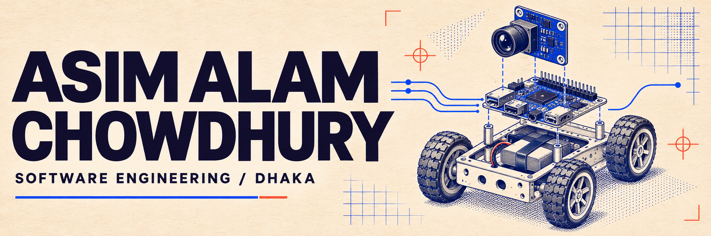

# 

I study Software Engineering at the University of Dhaka. I build AI agents that work with local documents, tools that show where their answers come from, and robots that can listen and see on-device.

[Portfolio](https://www.asim-alam.me/) · [LinkedIn](https://www.linkedin.com/in/asim-alam-chowdhury/) · [Repositories](https://github.com/asim-alam?tab=repositories)

## Selected work

### The Eye

A desktop research dashboard where cooperating agents search local documents and the web. I built a runtime context manager that decides what each agent sees on each turn.

`Electron` · `Next.js` · `Hybrid RAG` · [Project write-up ↗](https://www.asim-alam.me/work/the-eye)

### MaaSathi AI

A Bangla voice-first maternal health companion. Answers include references, and the app can route urgent cases to health workers.

`TypeScript` · `LangGraph` · `Supabase` · [Project write-up ↗](https://www.asim-alam.me/work/maasathi-ai)

### Voice-Controlled Tracking Robot

A small rover that recognizes spoken commands, tracks objects with an onboard camera, and avoids obstacles. Recognition runs on the ESP32 hardware.

`C++` · `ESP32-S3` · `TinyML` · [Source code ↗](https://github.com/asim-alam/voice-controlled-object-tracking-robot)

## GitHub activity

  <picture>
    <source media="(prefers-color-scheme: dark)" srcset="https://raw.githubusercontent.com/asim-alam/asim-alam/output/snake-dark.svg" />
    
  </picture>

  
Stats and repository languages

  

    
    
  

